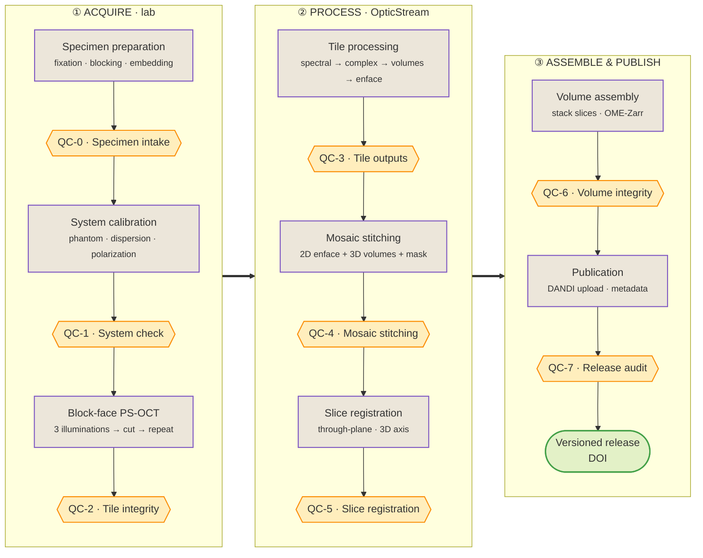
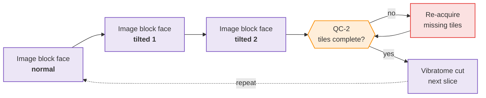
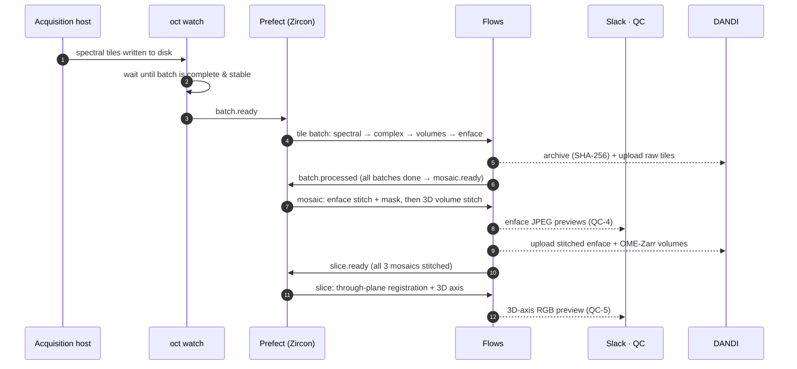

<div class="linc-hero" markdown>

<span class="linc-hero__eyebrow">LINC milestone · Quality-controlled release</span>

# Macaque PS-OCT pipeline

<p class="linc-hero__lead">
One protocol for macaque polarization-sensitive OCT (PS-OCT), from the block face to a published Dandiset.
It covers specimen preparation, acquisition, real-time processing, stitching and registration, volume assembly, and publication, with a quality-control gate at each stage.
</p>

<div class="linc-pills">
  <span class="linc-pill linc-pill--status">Release candidate</span>
  <span class="linc-pill">Protocol v1.0.0-rc1</span>
  <span class="linc-pill">PS-OCT · 1.3 µm</span>
  <span class="linc-pill">DANDI:001412</span>
</div>

[:material-database-outline: Browse the data](https://dandiarchive.org/dandiset/001412){ .md-button .md-button--primary }
[:material-cog-sync-outline: OpticStream](https://opticstream.lincbrain.org/){ .md-button }
[:material-swap-horizontal: LINC Convert](https://convert.lincbrain.org/){ .md-button }

</div>

!!! abstract "Milestone"

    **Release a quality-controlled workflow for the macaque pipeline: a combined protocol that covers both data acquisition and analysis.**

    This page is that protocol. It links the acquisition steps done in the lab to the automated processing in
    [OpticStream](https://opticstream.lincbrain.org/), the format conversion tools in
    [LINC Convert](https://convert.lincbrain.org/), and the public data in
    [DANDI:001412](https://dandiarchive.org/dandiset/001412). Each stage ends in a QC gate.
    The [release checklist](#release-checklist) lists what still has to be done before the milestone is closed.

!!! info "How to read this page"

    Values marked <span class="tbd">like this</span> are **placeholders or proposed defaults** that the acquisition
    and analysis leads still need to confirm. Unmarked numbers come from the current OpticStream configuration defaults
    (`opticstream.config.psoct_scan_config`).

<div class="linc-stats" markdown>
<div class="linc-stat"><strong>3</strong><span>Illuminations per slice</span></div>
<div class="linc-stat"><strong>10 µm</strong><span>Lateral sampling</span></div>
<div class="linc-stat"><strong>2.5 µm</strong><span>Axial sampling</span></div>
<div class="linc-stat"><strong>1.3 µm</strong><span>Center wavelength</span></div>
<div class="linc-stat"><strong>8</strong><span>QC gates</span></div>
</div>

## At a glance { #at-a-glance }

<div class="grid cards" markdown>

-   :material-microscope:{ .lg .middle } **Acquire**

    ---

    Serial block-face PS-OCT imaging. Each slice is imaged under one normal and two tilted illuminations before the next section is cut.

    [:octicons-arrow-right-24: Acquisition](#acquisition)

-   :material-cog-sync-outline:{ .lg .middle } **Process**

    ---

    Event-driven, real-time processing from tile to mosaic to slice, run by OpticStream and Prefect while acquisition continues.

    [:octicons-arrow-right-24: Processing](#processing)

-   :material-check-decagram-outline:{ .lg .middle } **Verify**

    ---

    Eight QC gates that combine automated checks, visual review in Slack, and a recorded sign-off.

    [:octicons-arrow-right-24: QC framework](#qc-framework)

-   :material-cloud-upload-outline:{ .lg .middle } **Publish**

    ---

    Raw tiles and derivatives stored on DANDI in a BIDS-style layout, with OME-Zarr volumes for streaming and viewing.

    [:octicons-arrow-right-24: Publication](#publication)

</div>

---

## End-to-end workflow { #overview }

The pipeline has three phases. Data moves left to right, and each step ends at a QC gate (amber) that must pass before work continues.



!!! danger "Acquisition is destructive: QC must run in real time"

    In serial block-face imaging, each slice is imaged and then **cut away**. A slice cannot be imaged again after
    the next section is cut. For this reason, gates **QC-1** and **QC-2**, and the first-slice checks in
    **QC-4**, must pass *during* the session, before the vibratome advances. Gates downstream of acquisition
    (QC-3 to QC-7) can always be fixed by **reprocessing** the archived raw tiles.

### Roles and responsibilities { #roles }

| Role | Responsibilities | Gates owned | Contact |
| --- | --- | --- | --- |
| :material-flask-outline: **Specimen lead** | Specimen sourcing, fixation, blocking, intake metadata | QC-0 | <span class="tbd">Name · email</span> |
| :material-microscope: **Acquisition operator** | System calibration, imaging sessions, run log, vibratome | QC-1, QC-2 | <span class="tbd">Name · email</span> |
| :material-server-outline: **Pipeline operator** | OpticStream deployment, Prefect workers, flow monitoring, reprocessing | QC-3, QC-6 | <span class="tbd">Name · email</span> |
| :material-eye-check-outline: **QC reviewer** | Visual review of stitched mosaics and registration, sign-off | QC-4, QC-5 | <span class="tbd">Name · email</span> |
| :material-archive-check-outline: **Data steward** | DANDI metadata, upload, validation, versioned release | QC-7 | <span class="tbd">Name · email</span> |

---

## Stage 0: Specimen preparation { #specimen }

<div class="linc-meta" markdown>
  <span>:material-account-outline: Specimen lead</span>
  <span>:material-map-marker-outline: Wet lab</span>
  <span>:material-check-decagram-outline: Gate QC-0</span>
</div>

1. **Source and approvals.** Record the specimen source and the ethics or IACUC protocol number: <span class="tbd">Protocol #</span>.
2. **Fixation.** Transcardial perfusion with <span class="tbd">4 % PFA</span>, followed by post-fixation for <span class="tbd">N days</span> at <span class="tbd">4 °C</span>.
3. **Ex vivo MRI (optional).** If a cross-modal reference is planned, acquire ex vivo MRI *before* blocking. Protocol: <span class="tbd">link to MRI protocol</span>.
4. **Blocking.** Cut the volume of interest (VOI) and photograph every face with a scale bar and orientation markers.
5. **Embedding.** Embed in <span class="tbd">agarose, % w/v</span> and mount on the vibratome stage of the PS-OCT system with a known orientation (record which face is superficial).

??? note "Specimen intake record (maps to DANDI subject and sample metadata)"

    | Field | Example | DANDI / BIDS mapping |
    | --- | --- | --- |
    | Subject ID | `sub-<ID>` | `participants.tsv` → `participant_id` |
    | Species | *Macaca mulatta* <span class="tbd">confirm</span> | `species` |
    | Sex / age / weight | <span class="tbd">F · 8 y · 7.2 kg</span> | `sex`, `age` |
    | Fixation and post-mortem interval | <span class="tbd">4 % PFA · PMI</span> | `samples.tsv` |
    | Hemisphere / VOI | `voi-<VOI>` | entity in filenames |
    | Block photographs | `sub-<ID>_voi-<VOI>_photo.jpg` | `derivatives/` <span class="tbd">confirm</span> |

!!! qc "QC-0 · Specimen intake"

    | Check | Method | Pass criterion | On failure |
    | --- | --- | --- | --- |
    | Metadata complete | :material-account-check: Checklist | All required fields in the intake record are filled | Hold the specimen until complete |
    | Tissue condition | :material-eye: Visual | No tears, freezing artifacts, or bubbles in the VOI | Record in notes; decide whether to proceed |
    | Orientation recorded | :material-eye: Visual | Photographs with orientation markers saved | Re-photograph before mounting |

---

## Stage 1: Acquisition { #acquisition }

<div class="linc-meta" markdown>
  <span>:material-account-outline: Acquisition operator</span>
  <span>:material-map-marker-outline: Acquisition host <span class="tbd">name</span></span>
  <span>:material-check-decagram-outline: Gates QC-1 · QC-2</span>
</div>

### System configuration { #system-configuration }

The macaque system acquires **three mosaics per slice** (one normal and two tilted illuminations). The human system acquires two.
These values are stored in the project's `PSOCTScanConfig` Prefect block.

| Parameter | Value | Config field |
| --- | --- | --- |
| Center wavelength | 1.3 µm | `acquisition.wavelength_um` |
| Sampling (x, y, z) | 10 × 10 × 2.5 µm | `acquisition.scan_resolution_3d` |
| Mosaics per slice | **3** (normal + 2 tilted) | `mosaics_per_slice` |
| Tile size: normal | 350 × 350 px | `tile_size_x_normal`, `tile_size_y` |
| Tile size: tilted | 200 × 350 px | `tile_size_x_tilted`, `tile_size_y` |
| Tile overlap | 20 % | `acquisition.tile_overlap` |
| Grid (columns × rows) | <span class="tbd">N × M (normal) · K × M (tilted)</span> | `grid_size_x_normal`, `grid_size_x_tilted`, `grid_size_y` |
| Slice thickness | <span class="tbd">confirm (pipeline default 500 µm)</span> | `acquisition.slice_thickness_um` |
| Tilt angle (γ) | <span class="tbd">± X°</span> | Used in slice registration |
| Tile saving type | `spectral` | `acquisition.tile_saving_type` |
| Objective / NA | <span class="tbd">e.g. 5×, NA 0.1</span> | n/a |
| Dispersion compensation | <span class="tbd">path to file</span> | `processing.disp_comp_file` |

### Before each session { #pre-session }

- [ ] Light source warmed up for at least <span class="tbd">30 min</span>.
- [ ] Reference (phantom) scan acquired and logged. Required for **QC-1**.
- [ ] Dispersion compensation file checked against the current system configuration.
- [ ] Polarization calibration acquired with a reference retarder of known retardance.
- [ ] At least <span class="tbd">4 TB</span> free on the acquisition volume, and the archive drive is mounted.
- [ ] Prefect server reachable at `http://<HOST_IP>:4200` and the workers are online.
- [ ] Project config block `<project>-psoct-config` exists and its values match the table above.
- [ ] The Slack QC channel <span class="tbd">#linc-macaque-qc</span> is receiving notifications.

### Configure and start the pipeline { #start-pipeline }

=== "1 · Create the project block"

    ```bash
    # Project names follow BIDS entities, e.g. sub-<ID>_voi-<VOI>
    opticstream oct setup sub-<ID>_voi-<VOI> \
      --project-base-path /data/<project> \
      --grid-size-x-normal <N> \
      --grid-size-x-tilted <K> \
      --grid-size-y <M>
    ```

    Then open **Prefect UI → Blocks → `<project>-psoct-config`** and set:
    `mosaics_per_slice: 3`, `dandiset_path`, `archive_path`, and the acquisition parameters listed above.

=== "2 · Start the acquisition watcher"

    ```bash
    # Slice n spans mosaics 3n-2 … 3n. Example: slices 1–4 → mosaics 1:12
    opticstream oct watch sub-<ID>_voi-<VOI> /path/to/spectral 1:12 \
      --stability-seconds 30
    ```

    The watcher only considers readable spectral files, groups them into complete batches, and waits until
    each batch has been unchanged on disk for `--stability-seconds`. It then either processes the batch directly or emits
    `linc.opticstream.psoct.batch.ready` for the deployed flows (`--no-direct`).

=== "3 · Monitor"

    - **Prefect dashboard:** `http://<HOST_IP>:4200` (flow runs, artifacts, and QC images)
    - **Slack:** <span class="tbd">#linc-macaque-qc</span> (enface previews per mosaic, 3D-axis previews per slice)
    - **State:** flag files under `mosaic-XX/state/` (`batch-NNN.started|processed|archived|uploaded`)

### Per-slice acquisition loop { #acquisition-loop }



!!! tip "Mosaic numbering"

    Mosaic IDs are sequential across the run: slice *n* consists of mosaics **3n−2**, **3n−1**, and **3n**
    (`first_mosaic_for_slice` in `opticstream.flows.psoct.utils`). Write the slice ↔ mosaic mapping in the run log
    for every session. Illumination order within a slice: <span class="tbd">normal, tilted 1, tilted 2</span>.

!!! qc "QC-1 · System check (start of every session)"

    | Check | Method | Pass criterion | On failure |
    | --- | --- | --- | --- |
    | Sensitivity / SNR on phantom | :material-robot: Auto + :material-eye: Visual | SNR ≥ <span class="tbd">X dB</span>; roll-off ≤ <span class="tbd">X dB/mm</span> | Realign; do **not** start imaging |
    | Polarization calibration | :material-robot: Auto | Measured retardance within ± <span class="tbd">X°</span> of the reference | Recalibrate polarization optics |
    | Focus and surface | :material-eye: Visual | Tissue surface inside the focus window on a test tile | Adjust z-stage and focus offset |
    | Disk and workers | :material-robot: Auto | Enough free space, Prefect workers healthy | Free space or restart workers |

!!! qc "QC-2 · Tile integrity (every batch, in real time)"

    | Check | Method | Pass criterion | On failure |
    | --- | --- | --- | --- |
    | Completeness | :material-robot: Watcher | Tile count = grid columns × rows for each mosaic | Re-acquire the missing tiles **before cutting** |
    | Readability and stability | :material-robot: Watcher | Every file readable; fingerprint stable for the stability window | Wait or re-copy; `--force-resend` |
    | Checksums | :material-robot: Archive flow | SHA-256 recorded at archive time and matched after upload (`compare_hash_files`) | Re-archive and re-upload the batch |
    | Visual spot check | :material-eye: Operator | First tile of each mosaic shows tissue with no saturation or banding | Pause, inspect, re-acquire |

---

## Stage 2: Real-time processing { #processing }

<div class="linc-meta" markdown>
  <span>:material-account-outline: Pipeline operator · QC reviewer</span>
  <span>:material-map-marker-outline: Processing host (Zircon) + auxiliary hosts</span>
  <span>:material-check-decagram-outline: Gates QC-3 · QC-4 · QC-5</span>
</div>

Processing is hierarchical (**tile → mosaic → slice → specimen**). Prefect events coordinate the levels: each level starts
automatically when all of its inputs have finished. State is kept in flag files and in the OpticStream project-state service,
so any flow can be re-run safely (flows are idempotent).



### 2.1 Tile processing { #tile-processing }

| Step | What happens | Implementation |
| --- | --- | --- |
| Metadata parsing | Slice, mosaic, tile index, and illumination are read from the filename | `tile_file_reference.py` |
| Integrity and compression | SHA-256 checksum computed, raw tile compressed to `.nii.gz` | `tile_batch_archive_flow.py` |
| Spectral → complex | MATLAB batch conversion (complex inputs are symlinked instead) | `psoct-toolbox` |
| Complex → 3D volumes | `dBI`, `R3D`, `O3D` volumes | `psoct-toolbox` |
| Surface finding | Automatic tissue-surface detection | `processing.surface_spec` |
| Enface generation | `aip`, `mip`, `ret`, `ori`, `biref`, `surf` from a depth window below the surface | `enface_offset`, `enface_depth` (70 px) |
| Validation | Every configured modality exists and is above a minimum size | `tile_batch_processed_validation.py` |

!!! qc "QC-3 · Tile outputs"

    | Check | Method | Pass criterion | On failure |
    | --- | --- | --- | --- |
    | Outputs present | :material-robot: Auto | Every configured enface and volume modality exists per tile, ≥ <span class="tbd">min size</span> | Re-run the tile batch flow |
    | Surface finding | :material-eye: Visual (Prefect artifact) | Surface overlay follows the tissue boundary on QC images | Adjust `surface_spec`; reprocess the batch |
    | Batch failures | :material-robot: Auto | No failed batches left in Prefect | Retry the batch on its own (other tiles are not blocked) |

### 2.2 Mosaic stitching { #mosaic-stitching }

!!! warning "The first slice of each illumination sets the template for the whole run"

    For the **first slice**, OpticStream computes a **tile-coordinate template** (`tilemap-<illum>.j2`) and a
    **focus plane** (`focus-<illum>.nii`) for every illumination. All later slices **reuse** these files.
    An error here affects every slice after it, so first-slice review is a **blocking** part of QC-4.

1. **Apply the coordinate template** to the tiles of the current mosaic.
2. **Stitch the 2D enface modalities** (AIP, MIP, retardance, orientation, birefringence, surface) with the same template.
3. **Generate a mask** from the stitched AIP (threshold: 60 for normal, 55 for tilted) and apply it to all outputs.
4. **Stitch the 3D volumes** (`dBI`, `R3D`, `O3D`) using the focus plane, cropped to 500 px depth with a 30 px offset.
5. **Publish previews:** JPEG enface previews are posted to Slack and to Prefect artifacts for review.

!!! qc "QC-4 · Mosaic stitching (every mosaic, blocking on the first slice)"

    | Check | Method | Pass criterion | On failure |
    | --- | --- | --- | --- |
    | Seams and alignment | :material-eye: Visual (Slack preview) | No visible seams or duplicated structures in AIP and retardance | Recompute the coordinate template (first slice) or re-stitch |
    | Overlap QC image | :material-eye: Visual | Overlap regions agree across neighboring tiles | Check grid size and tile order in the config |
    | Focus plane (first slice) | :material-eye: Visual | Focus plane overlaps the high-intensity tissue band | Re-run focus finding before the next cut |
    | Mask coverage | :material-robot: Auto + :material-eye: | Tissue fully inside the mask; area within ± <span class="tbd">10 %</span> of the previous slice | Adjust `mask_threshold_normal` / `_tilted` |
    | Review latency | :material-account-check: Reviewer | Signed off within <span class="tbd">24 h</span> (first slice: before the next cut) | Escalate to the acquisition lead |

### 2.3 Slice registration { #slice-registration }

When all **three** mosaics of a slice are stitched, `slice.ready` triggers the slice flow. It **registers the tilted
illuminations to the normal illumination** (through-plane registration, using the tilt angle γ), combines the
orientation information from the different angles into a **3D fiber-axis** estimate, and writes an RGB visualization.
This step needs a lot of compute but little I/O, so it can run on auxiliary hosts.

!!! qc "QC-5 · Slice registration"

    | Check | Method | Pass criterion | On failure |
    | --- | --- | --- | --- |
    | Illumination alignment | :material-eye: Visual | Tilted mosaics overlay the normal mosaic with no visible offset | Check γ and re-run registration |
    | Registration residual | :material-robot: Auto | Residual ≤ <span class="tbd">N px</span> | Re-run with a different initialization |
    | 3D-axis plausibility | :material-eye: Visual (RGB) | Known tracts show the expected orientation color, e.g. <span class="tbd">corpus callosum</span> | Flag for expert review |

---

## Stage 3: Volume assembly and conversion { #assembly }

<div class="linc-meta" markdown>
  <span>:material-account-outline: Pipeline operator</span>
  <span>:material-map-marker-outline: Processing host / cluster</span>
  <span>:material-check-decagram-outline: Gate QC-6</span>
</div>

Per-slice 3D volumes are already written as **OME-Zarr** by OpticStream (through `nifti-zarr`).
Assembling the whole specimen is currently a **manual** step:

1. **Collect** the stitched per-slice outputs for each modality and illumination in slice order.
2. **Stack** the 2D mosaics and 3D volumes across slices. Script: <span class="tbd">reference stacking script</span>
   (prototype: `opticstream/notebooks/stack.py`).
3. **Convert** MATLAB outputs (for example the through-plane and in-plane `.mat` files) to OME-Zarr or NIfTI-Zarr with LINC Convert:

    ```bash
    linc-convert psoct multi_slice slice-*.mat \
      --key <MATLAB_KEY> \
      -o sub-<ID>_voi-<VOI>_proc-<modality>_OCT.ome.zarr
    ```

4. **(Optional) Register to MRI** if an ex vivo MRI reference exists. Method: <span class="tbd">tool / transform format</span>.

!!! qc "QC-6 · Volume integrity"

    | Check | Method | Pass criterion | On failure |
    | --- | --- | --- | --- |
    | Slice continuity | :material-robot: Auto | No missing or duplicated slice IDs; count matches the run log | Find the gap in the run log and reprocess the slice |
    | Spacing and voxel size | :material-robot: Auto | z spacing = slice thickness; voxel size in the OME-Zarr metadata matches the config | Fix the metadata and rewrite |
    | Orientation | :material-eye: Visual | RAS orientation agrees with the block photographs | Fix the affine or header |
    | Pyramid / chunks | :material-robot: Auto | OME-Zarr passes validation; all pyramid levels present | Re-run the conversion |
    | Viewer load | :material-eye: Visual | Loads in [Neuroglancer](../neuroglancer.md) at every resolution level | Check chunking and sharding settings |

---

## Stage 4: Publication and release { #publication }

<div class="linc-meta" markdown>
  <span>:material-account-outline: Data steward</span>
  <span>:material-map-marker-outline: DANDI Archive</span>
  <span>:material-check-decagram-outline: Gate QC-7</span>
</div>

Raw tiles are uploaded as they are archived. Stitched derivatives are uploaded as each mosaic finishes.
OpticStream's `upload_to_dandi_batch` task calls the DANDI CLI and can target either the DANDI or the LINC instance.

??? example "Dandiset layout (DANDI:001412)"

    ```text
    001412/
    ├── dandiset.yaml
    ├── participants.tsv
    ├── samples.tsv
    ├── rawdata/
    │   └── sub-<ID>/voi-<VOI>/sample-slice<NN>/acq-<ACQ>/
    │       └── sub-<ID>_voi-<VOI>_sample-slice<NN>_acq-<ACQ>_chunk-<TTTT>_OCT.nii.gz
    └── derivatives/
        ├── sub-<ID>/
        │   ├── *_sample-slice<NN>_acq-<ACQ>_proc-<enface>_OCT.nii.gz   # 2D enface mosaics
        │   ├── *_sample-slice<NN>_acq-<ACQ>_proc-<volume>_OCT.ome.zarr # 3D volumes
        │   ├── *_sample-slice<NNN>_acq-<ACQ>_OCT_mask.nii.gz          # tissue masks
        │   └── *_sample-slice<NNN>_proc-3daxis_OCT.nii.gz             # 3D fiber axis
        └── qc/                                                       # QC records (see below)
    ```

    This layout follows the OpticStream naming templates. <span class="tbd">Check it against the current Dandiset tree.</span>

```bash
# Validate, then upload from the local dandiset root
dandi validate .
dandi upload -i dandi        # or: -i linc for the LINC instance
```

!!! qc "QC-7 · Release audit"

    | Check | Method | Pass criterion | On failure |
    | --- | --- | --- | --- |
    | DANDI validation | :material-robot: Auto | `dandi validate` reports no errors | Fix the filenames or metadata |
    | Checksums | :material-robot: Auto | Every archived raw tile matches its archive-time SHA-256 | Re-upload the affected tiles |
    | Completeness | :material-robot: Auto | Every slice × illumination × modality listed in the run log is present | Upload what is missing |
    | QC records | :material-account-check: Steward | One QC record per gate per slice in `derivatives/qc/` | Collect the missing sign-offs |
    | Metadata | :material-account-check: Steward | Description, contributors, license, protocol link, and funding are complete | Edit the Dandiset metadata |
    | Publish | :material-account-check: Leads | Version published with a DOI; release notes written | n/a |

---

## QC framework { #qc-framework }

### Gate summary { #gate-summary }

| Gate | Stage | Focus | Type | Timing | Recoverable by |
| --- | --- | --- | --- | --- | --- |
| **QC-0** | Specimen | Intake metadata and tissue condition | :material-account-check: Sign-off | Before mounting | n/a |
| **QC-1** | Acquisition | System sensitivity, polarization, focus | :material-robot: :material-eye: | Every session | Recalibration |
| **QC-2** | Acquisition | Tile completeness, readability, checksums | :material-robot: | Every batch, real time | **Re-acquisition (before the cut only)** |
| **QC-3** | Tile processing | Processed outputs, surface finding | :material-robot: :material-eye: | Every batch | Reprocessing |
| **QC-4** | Mosaic | Stitching, focus, mask | :material-eye: :material-account-check: | Every mosaic | Re-stitching |
| **QC-5** | Slice | Illumination registration, 3D axis | :material-robot: :material-eye: | Every slice | Re-registration |
| **QC-6** | Specimen volume | Continuity, spacing, orientation, format | :material-robot: :material-eye: | Per release | Re-assembly |
| **QC-7** | Publication | Validation, completeness, metadata | :material-robot: :material-account-check: | Per release | Re-upload |

<small>:material-robot: automated · :material-eye: visual review · :material-account-check: recorded sign-off</small>

### Outcome levels { #outcome-levels }

| Outcome | Meaning | Data released? |
| --- | --- | --- |
| :material-check-circle:{ .qc-pass } **Pass** | Meets all criteria | Yes |
| :material-alert-circle:{ .qc-warn } **Pass with notes** | Minor artifact recorded; usable for analysis | Yes, with a note in the QC record |
| :material-refresh-circle:{ .qc-redo } **Fail: reprocess** | Processing problem; raw data intact | After reprocessing |
| :material-close-circle:{ .qc-fail } **Fail: re-acquire / unrecoverable** | Raw data missing or corrupt | Raw data released with an exclusion flag <span class="tbd">confirm policy</span> |

### QC record template { #qc-record }

Each gate decision is saved as a small machine-readable record and published with the data in `derivatives/qc/`.

```yaml
# derivatives/qc/sub-<ID>_voi-<VOI>_sample-slice<NN>_gate-QC4_acq-normal.yaml
subject: sub-<ID>
voi: <VOI>
slice: 12
gate: QC-4
illumination: normal          # normal | tilted1 | tilted2
outcome: pass                 # pass | pass-with-notes | fail-reprocess | fail-reacquire
reviewer: <name>
reviewed_at: 2026-11-17T14:05:00Z
metrics:
  mask_area_change_pct: 3.1
  seam_artifacts: none
evidence:
  - prefect_artifact: <artifact URL>
  - slack_thread: <permalink>
software:
  opticstream: <commit>
  psoct_toolbox: <commit>
notes: ""
```

### Common failures and fixes { #troubleshooting }

??? failure "A batch never dispatches"

    The watcher only dispatches **complete** and **stable** batches. Check that the number of tiles matches `grid_size_y`
    and that no file is still being written. If a batch already has state from an earlier attempt, re-run it with `--force-resend`.

??? failure "The surface overlay misses the tissue"

    Adjust `processing.surface_spec` and reprocess the affected batches. On the first slice, also re-run focus finding,
    because it relies on accurate surface data.

??? failure "Visible seams in the stitched mosaic"

    The coordinate template is usually the cause. Recompute it from the first slice of that illumination, then re-stitch.
    Check the grid size and tile ordering in the config as well.

??? failure "The mask clips tissue or keeps background"

    Tune `mask_threshold_normal` (default 60) or `mask_threshold_tilted` (default 55) and re-stitch.
    Record the new value in the QC record.

??? failure "Tilted and normal mosaics are misaligned"

    Check the tilt angle γ used in registration and re-run the slice flow. Persistent misalignment can point to
    mechanical drift between illuminations. Report it to the acquisition operator.

??? failure "Upload failures"

    Uploads are separate from compute. Retry the upload flow for the affected batch or mosaic only. Checksums are
    compared again at QC-7.

---

## Data products { #data-products }

=== "2D enface (per mosaic)"

    | Modality | Description | Format |
    | --- | --- | --- |
    | `aip` | Average intensity projection | NIfTI (`.nii.gz`), JPEG preview |
    | `mip` | Maximum intensity projection | NIfTI, JPEG |
    | `ret` | Retardance | NIfTI, JPEG |
    | `ori` | In-plane optic-axis orientation | NIfTI, JPEG |
    | `biref` | Birefringence | NIfTI, JPEG |
    | `surf` | Tissue surface depth map | NIfTI, JPEG |
    | `mask` | Tissue mask derived from AIP | NIfTI |

    Pattern: `{project}_sample-slice{NN}_acq-{acq}_proc-{modality}_OCT.nii.gz`

=== "3D volumes (per mosaic)"

    | Modality | Description | Format |
    | --- | --- | --- |
    | `dBI` | Reflectivity (intensity, dB) | OME-Zarr |
    | `R3D` | Retardance volume | OME-Zarr |
    | `O3D` | Optic-axis orientation volume | OME-Zarr |

    Pattern: `{project}_sample-slice{NN}_acq-{acq}_proc-{modality}_OCT.ome.zarr`

=== "Slice and specimen level"

    | Product | Description | Format |
    | --- | --- | --- |
    | `3daxis` | 3D fiber axis from combining the illuminations | NIfTI, RGB JPEG |
    | Through-plane / in-plane | Registration outputs | MATLAB `.mat` → OME-Zarr via LINC Convert |
    | Stacked volume | All slices for one modality | OME-Zarr <span class="tbd">naming TBD</span> |

=== "Raw"

    | Product | Description | Format |
    | --- | --- | --- |
    | Spectral tiles | Compressed raw tiles with SHA-256 | `.nii.gz` under `rawdata/` |

---

## Access the data { #access }

=== ":material-console: DANDI CLI"

    ```bash
    pip install dandi

    # Whole dandiset (large!)
    dandi download https://dandiarchive.org/dandiset/001412/draft

    # A single subject's derivatives
    dandi download "dandi://dandi/001412@draft/derivatives/sub-<ID>/"
    ```

=== ":material-language-python: Python"

    ```python
    from dandi.dandiapi import DandiAPIClient

    with DandiAPIClient() as client:
        ds = client.get_dandiset("001412", "draft")
        for asset in ds.get_assets_with_path_prefix("derivatives/"):
            print(asset.path, asset.size)
    ```

    To stream OME-Zarr volumes without downloading them, see [Stream Zarr](../stream-zarr.ipynb).

=== ":material-eye-outline: Visualize"

    Open OME-Zarr derivatives in Neuroglancer from the DANDI asset page, or follow
    [Visualize data in Neuroglancer](../neuroglancer.md).

---

## Software and environment { #software }

| Component | Role | Release pin | Source |
| --- | --- | --- | --- |
| **OpticStream** | Acquisition watchers, Prefect flows, QC artifacts, uploads | <span class="tbd">vX.Y.Z / commit</span> | [docs](https://opticstream.lincbrain.org/) · [code](https://github.com/lincbrain/opticstream) |
| **LINC Convert** | PS-OCT, LSM, and dark-field → OME-Zarr / NIfTI-Zarr; mosaic stitching | <span class="tbd">vX.Y.Z / commit</span> | [docs](https://convert.lincbrain.org/) · [code](https://github.com/lincbrain/linc-convert) |
| **psoct-toolbox** | MATLAB PS-OCT reconstruction (spectral → complex → volumes) | <span class="tbd">commit</span> | <span class="tbd">repository link</span> |
| **nifti-zarr** | NIfTI-Zarr / OME-Zarr writer | <span class="tbd">commit</span> | <span class="tbd">repository link</span> |
| **Prefect** | Workflow orchestration, events, artifacts | <span class="tbd">3.x</span> | [prefect.io](https://www.prefect.io/) |
| **MATLAB** | Runtime for psoct-toolbox | <span class="tbd">R20XXx</span> | n/a |
| **DANDI CLI** | Validation and upload | <span class="tbd">0.x</span> | [docs](https://dandi.readthedocs.io) |

!!! warning "Pin dependencies for the release"

    OpticStream currently installs `linc-convert`, `nifti-zarr`, and `psoct-toolbox` from **git branches**.
    Before the release, pin each one to a tag or commit and record the pins here and in the QC records,
    so that the published derivatives can be reproduced.

---

## Release checklist { #release-checklist }

Acceptance criteria for closing the milestone:

- [x] Real-time PS-OCT processing pipeline implemented (OpticStream flows from tile to slice)
- [x] Conversion tooling available (LINC Convert `psoct` pipelines)
- [x] Data deposited on DANDI ([001412](https://dandiarchive.org/dandiset/001412), draft)
- [x] Combined acquisition and analysis protocol written (this page)
- [ ] Every <span class="tbd">placeholder</span> on this page replaced with a confirmed value
- [ ] Slice registration checked for **three** illuminations (the current flow registers one normal/tilted pair)
- [ ] Specimen-level stacking scripted and added to the pipeline (currently manual)
- [ ] Dependencies pinned to tagged releases
- [ ] One complete specimen processed with all eight gates recorded
- [ ] QC records published in `derivatives/qc/`
- [ ] `dandi validate` clean; Dandiset metadata complete
- [ ] Dandiset version published with a DOI
- [ ] Protocol signed off by the acquisition and analysis leads

### Known limitations and roadmap { #roadmap }

| Item | Status | Plan |
| --- | --- | --- |
| Assembling all slices into one volume | :material-progress-wrench: Manual | Add a Prefect flow triggered by the last `slice.registered` event |
| Registration with three illuminations | :material-progress-question: To verify | Extend the slice flow from one normal/tilted pair to normal + 2 tilted |
| MATLAB dependency | :material-progress-clock: Planned | Migrate reconstruction to Python |
| Algorithm documentation | :material-progress-pencil: In progress | Write up coordinate determination, focus finding, and stitching in OpticStream |
| Cross-modal registration to MRI | <span class="tbd">TBD</span> | <span class="tbd">Owner and approach</span> |

---

## Revision history { #revision-history }

| Version | Date | Author | Changes |
| --- | --- | --- | --- |
| v1.0.0-rc1 | 2026-11-17 | <span class="tbd">Author</span> | First combined acquisition and analysis protocol with QC gates |
| v1.0.0 | <span class="tbd">YYYY-MM-DD</span> | <span class="tbd">Author</span> | Thresholds confirmed; released with the Dandiset version |

!!! question "Questions or corrections?"

    Ask in the LINC [Slack](https://mit-lincbrain.slack.com/) <span class="tbd">#channel</span> or open an issue on
    [lincbrain/linc-docs](https://github.com/lincbrain/linc-docs/issues). Pipeline bugs go to
    [OpticStream](https://github.com/lincbrain/opticstream/issues) or
    [LINC Convert](https://github.com/lincbrain/linc-convert/issues).
