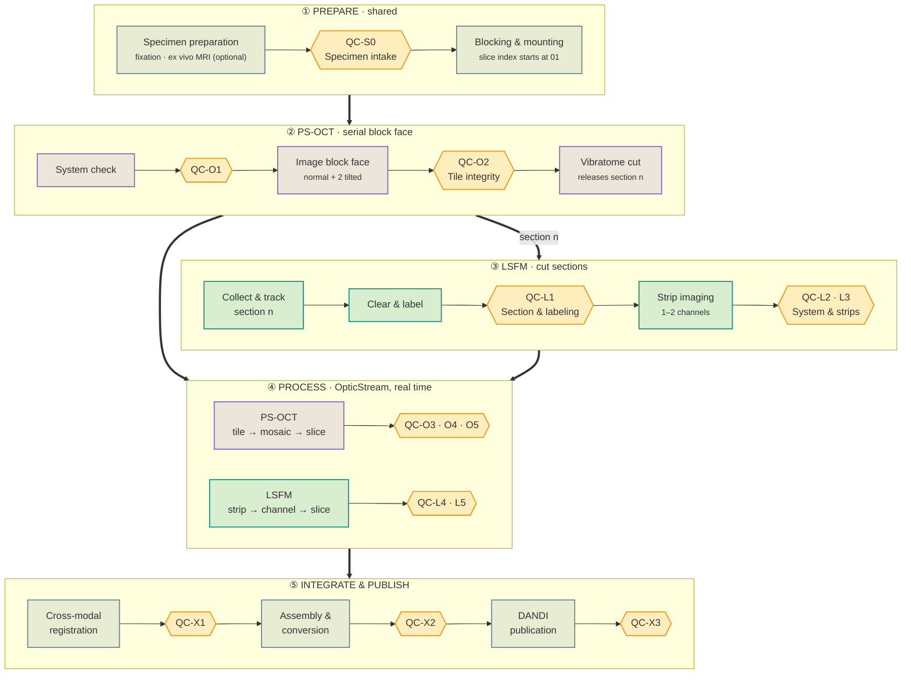
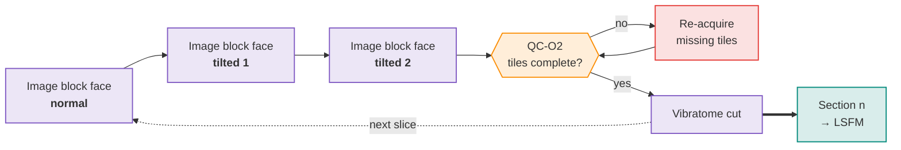
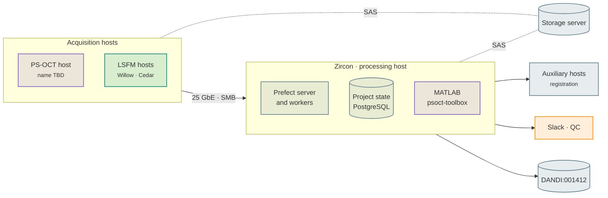
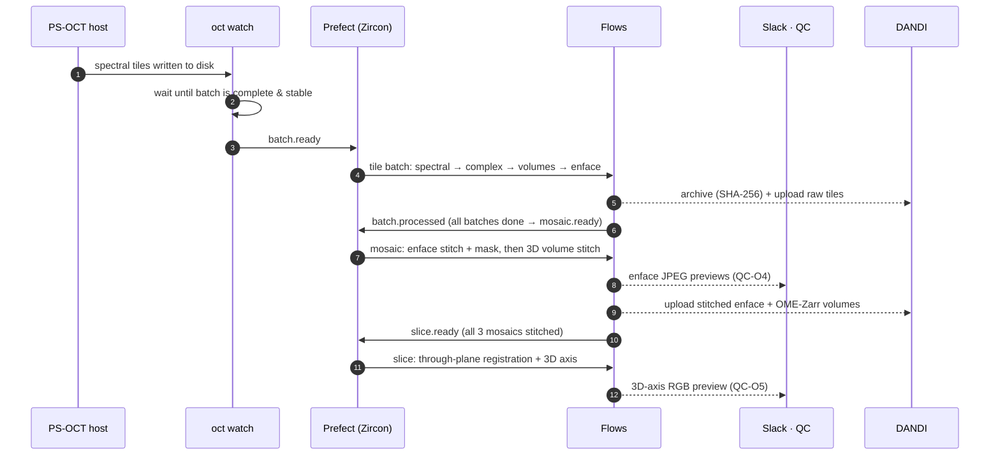
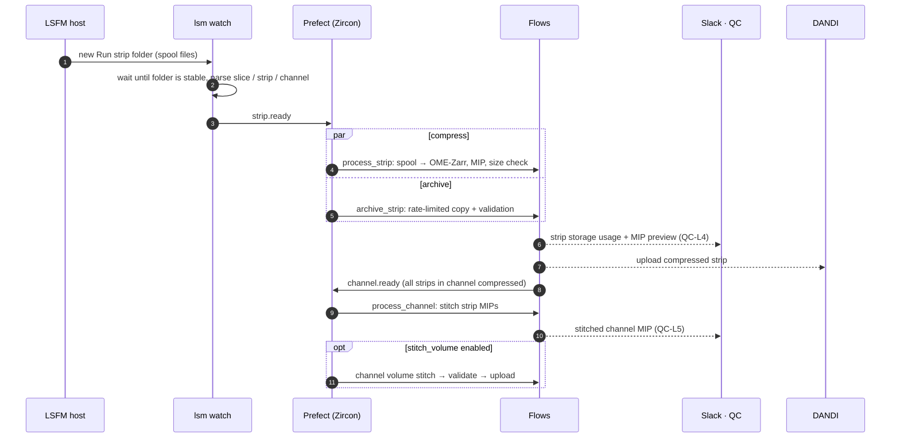
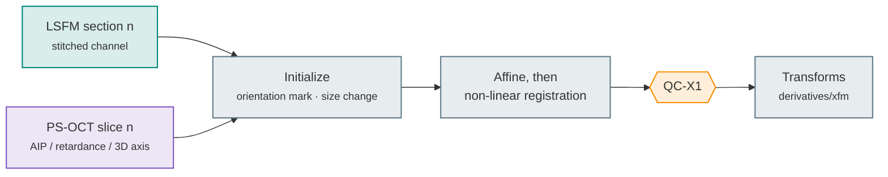

<div class="linc-hero" markdown>

<span class="linc-hero__eyebrow">LINC milestone · Quality-controlled release</span>

# Macaque LSFM + PS-OCT pipeline

<p class="linc-hero__lead">
One protocol for two imaging systems that image the same macaque tissue.
PS-OCT images the block face without labels, slice by slice. Each section it cuts off is then cleared, labeled, and imaged with
light-sheet fluorescence microscopy (LSFM). OpticStream processes both data streams in real time,
and both are registered, quality controlled, and published to DANDI together.
</p>

<div class="linc-pills">
  <span class="linc-pill linc-pill--status">Release candidate</span>
  <span class="linc-pill">Protocol v1.0.0-rc2</span>
  <span class="linc-pill">PS-OCT · 1.3 µm</span>
  <span class="linc-pill">LSFM · 1–2 channels</span>
  <span class="linc-pill">DANDI:001412</span>
</div>

[:material-database-outline: Browse the data](https://dandiarchive.org/dandiset/001412){ .md-button .md-button--primary }
[:material-cog-sync-outline: OpticStream](https://opticstream.lincbrain.org/){ .md-button }
[:material-swap-horizontal: LINC Convert](https://convert.lincbrain.org/){ .md-button }

</div>

!!! abstract "Milestone"

    **Release a quality-controlled workflow for the macaque pipeline: a combined protocol that covers both data acquisition and analysis.**

    This page is that protocol for the **combined LSFM and PS-OCT systems**. It links the acquisition steps done in the lab
    on both instruments to the automated processing in [OpticStream](https://opticstream.lincbrain.org/), the format
    conversion tools in [LINC Convert](https://convert.lincbrain.org/), and the public data in
    [DANDI:001412](https://dandiarchive.org/dandiset/001412). Each stage ends in a QC gate.
    The [release checklist](#release-checklist) lists what still has to be done before the milestone is closed.

!!! info "How to read this page"

    Values marked <span class="tbd">like this</span> are **placeholders or proposed defaults** that the acquisition
    and analysis leads still need to confirm. Unmarked numbers come from the current OpticStream configuration defaults
    (`opticstream.config.psoct_scan_config` and `opticstream.config.lsm_scan_config`).
    Gate IDs are prefixed by system: **S** = shared, **O** = PS-OCT, **L** = LSFM, **X** = cross-modal.

<div class="linc-stats" markdown>
<div class="linc-stat"><strong>2</strong><span>Imaging systems</span></div>
<div class="linc-stat"><strong>1</strong><span>Shared slice index</span></div>
<div class="linc-stat"><strong>3</strong><span>PS-OCT illuminations per slice</span></div>
<div class="linc-stat"><strong>≤ 2</strong><span>LSFM channels per section</span></div>
<div class="linc-stat"><strong>14</strong><span>QC gates</span></div>
</div>

## At a glance { #at-a-glance }

<div class="grid cards" markdown>

-   :material-flask-outline:{ .lg .middle } **Prepare**

    ---

    Fix, block, and mount one specimen. The slice index assigned here is used by both systems.

    [:octicons-arrow-right-24: Specimen preparation](#specimen)

-   :material-microscope:{ .lg .middle } **PS-OCT · block face**

    ---

    Label-free serial block-face imaging of fiber architecture (retardance, orientation, birefringence) with three illuminations per slice.

    [:octicons-arrow-right-24: PS-OCT acquisition](#psoct-acquisition)

-   :material-flare:{ .lg .middle } **LSFM · cut sections**

    ---

    Each section cut during PS-OCT imaging is tracked, cleared, labeled, and imaged in strips on the light-sheet system.

    [:octicons-arrow-right-24: LSFM acquisition](#lsfm-acquisition)

-   :material-cog-sync-outline:{ .lg .middle } **Process**

    ---

    OpticStream runs both data streams in real time on shared infrastructure (Prefect, project state, Slack QC, DANDI upload).

    [:octicons-arrow-right-24: Processing](#processing)

-   :material-vector-link:{ .lg .middle } **Integrate**

    ---

    Each LSFM section is registered to the PS-OCT data for the same slice, then each modality is assembled into a whole-specimen volume.

    [:octicons-arrow-right-24: Integration](#integration)

-   :material-check-decagram-outline:{ .lg .middle } **Verify & publish**

    ---

    Fourteen QC gates with recorded sign-off, then one versioned Dandiset that holds both modalities.

    [:octicons-arrow-right-24: QC framework](#qc-framework)

</div>

---

## Two systems, one specimen { #systems }

| | :material-microscope: **PS-OCT** | :material-flare: **LSFM** |
| --- | --- | --- |
| **What it measures** | Label-free contrast: reflectivity, retardance, optic-axis orientation, birefringence | Fluorescence from labels: <span class="tbd">e.g. tracer, cell, or axon markers</span> |
| **Tissue state** | Fixed block, imaged at the block face *before* each cut | Cut section, imaged *after* clearing and labeling |
| **Acquisition unit** | Tile → batch → mosaic (3 mosaics per slice) | Strip (`Run*` folder) → channel → slice |
| **Raw data** | Spectral NIfTI tiles | Camera spool `.dat` files, one folder per strip |
| **Sampling** | 10 × 10 × 2.5 µm | <span class="tbd">x × y × z µm</span> |
| **Acquisition host** | <span class="tbd">host name</span> | Willow / Cedar <span class="tbd">confirm for macaque</span> |
| **Watcher** | `opticstream oct watch` | `opticstream lsm watch` |
| **Config block** | `<project>-psoct-config` | `<project>-lsm-config` |
| **State hierarchy** | project → slice → mosaic → batch | project → slice → channel → strip |
| **Events** | `linc.opticstream.psoct.*` | `linc.opticstream.lsm.*` |
| **Real-time QC** | Enface JPEG previews, 3D-axis RGB | Strip MIP previews, stitched channel MIP |
| **Conversion** | `linc-convert psoct …` | `linc-convert lsm …` |

!!! success "The link between the two systems: one slice index for the same tissue"

    PS-OCT images the top of the block for slice *n*. The vibratome then cuts that tissue off as **section *n***, which
    becomes the LSFM sample. Because both datasets describe **the same physical tissue**, it is possible to register
    LSFM to PS-OCT slice by slice. Both systems use the same BIDS entity `sample-slice<NN>`. When an LSFM session does
    not start at section 1, use `opticstream lsm watch --slice-offset` so that LSFM numbering matches the project
    slice index.

---

## End-to-end workflow { #overview }



<div class="linc-legend">
  <span class="linc-legend__item linc-legend__item--shared">Shared</span>
  <span class="linc-legend__item linc-legend__item--oct">PS-OCT</span>
  <span class="linc-legend__item linc-legend__item--lsm">LSFM</span>
  <span class="linc-legend__item linc-legend__item--gate">QC gate</span>
</div>

!!! danger "Block-face imaging cannot be repeated: PS-OCT QC must run in real time"

    After slice *n* is cut, its block face is gone and cannot be imaged by PS-OCT again. Gates **QC-O1**, **QC-O2**, and
    the first-slice checks in **QC-O4** must therefore pass *during* the session, before the vibratome advances.
    The cut section survives, so **LSFM can be re-imaged** as long as the section is intact and correctly tracked.
    All processing gates can be fixed by **reprocessing** the archived raw data.

### Roles and responsibilities { #roles }

| Role | Responsibilities | Gates owned | Contact |
| --- | --- | --- | --- |
| :material-flask-outline: **Specimen lead** | Specimen sourcing, fixation, blocking, intake metadata | QC-S0 | <span class="tbd">Name · email</span> |
| :material-microscope: **PS-OCT operator** | PS-OCT calibration, block-face imaging, vibratome, run log | QC-O1, QC-O2 | <span class="tbd">Name · email</span> |
| :material-test-tube: **Histology lead** | Section collection and tracking, clearing, labeling, mounting | QC-L1 | <span class="tbd">Name · email</span> |
| :material-flare: **LSFM operator** | LSFM calibration, strip imaging, acquisition-host health | QC-L2, QC-L3 | <span class="tbd">Name · email</span> |
| :material-server-outline: **Pipeline operator** | OpticStream deployments, Prefect workers, monitoring, reprocessing | QC-O3, QC-L4, QC-X2 | <span class="tbd">Name · email</span> |
| :material-eye-check-outline: **QC reviewer** | Visual review of stitched PS-OCT mosaics, registration, and LSFM channel mosaics | QC-O4, QC-O5, QC-L5 | <span class="tbd">Name · email</span> |
| :material-vector-link: **Registration lead** | Cross-modal registration of LSFM to PS-OCT (and optionally MRI) | QC-X1 | <span class="tbd">Name · email</span> |
| :material-archive-check-outline: **Data steward** | DANDI metadata, upload, validation, versioned release | QC-X3 | <span class="tbd">Name · email</span> |

---

## Stage 0: Specimen preparation { #specimen }

<div class="linc-meta" markdown>
  <span>:material-account-outline: Specimen lead</span>
  <span>:material-map-marker-outline: Wet lab</span>
  <span>:material-check-decagram-outline: Gate QC-S0</span>
</div>

1. **Source and approvals.** Record the specimen source and the ethics or IACUC protocol number: <span class="tbd">Protocol #</span>.
2. **Fixation.** Transcardial perfusion with <span class="tbd">4 % PFA</span>, followed by post-fixation for <span class="tbd">N days</span> at <span class="tbd">4 °C</span>.
   Fixation must suit both PS-OCT contrast and the LSFM labels: <span class="tbd">confirm compatibility with the labeling protocol</span>.
3. **Ex vivo MRI (optional).** If a cross-modal reference is planned, acquire ex vivo MRI *before* blocking. Protocol: <span class="tbd">link to MRI protocol</span>.
4. **Blocking.** Cut the volume of interest (VOI) and photograph every face with a scale bar and orientation markers.
5. **Embedding and mounting.** Embed in <span class="tbd">agarose, % w/v</span> and mount on the vibratome stage of the PS-OCT system with a known orientation.
   Record which face is superficial. This becomes slice `01` for **both** systems.

??? note "Specimen intake record (maps to DANDI subject and sample metadata)"

    | Field | Example | DANDI / BIDS mapping |
    | --- | --- | --- |
    | Subject ID | `sub-<ID>` | `participants.tsv` → `participant_id` |
    | Species | *Macaca mulatta* <span class="tbd">confirm</span> | `species` |
    | Sex / age / weight | <span class="tbd">F · 8 y · 7.2 kg</span> | `sex`, `age` |
    | Fixation and post-mortem interval | <span class="tbd">4 % PFA · PMI</span> | `samples.tsv` |
    | Hemisphere / VOI | `voi-<VOI>` | entity in filenames |
    | Labeling plan | <span class="tbd">labels per channel</span> | `samples.tsv` <span class="tbd">confirm</span> |
    | Block photographs | `sub-<ID>_voi-<VOI>_photo.jpg` | `derivatives/` <span class="tbd">confirm</span> |

!!! qc "QC-S0 · Specimen intake"

    | Check | Method | Pass criterion | On failure |
    | --- | --- | --- | --- |
    | Metadata complete | :material-account-check: Checklist | All required fields in the intake record are filled, including the labeling plan | Hold the specimen until complete |
    | Tissue condition | :material-eye: Visual | No tears, freezing artifacts, or bubbles in the VOI | Record in notes; decide whether to proceed |
    | Orientation recorded | :material-eye: Visual | Photographs with orientation markers saved | Re-photograph before mounting |

---

## Stage 1: PS-OCT acquisition { #psoct-acquisition }

<div class="linc-meta" markdown>
  <span>:material-account-outline: PS-OCT operator</span>
  <span>:material-map-marker-outline: PS-OCT host <span class="tbd">name</span></span>
  <span>:material-check-decagram-outline: Gates QC-O1 · QC-O2</span>
</div>

### System configuration { #psoct-configuration }

The macaque PS-OCT system acquires **three mosaics per slice** (one normal and two tilted illuminations). The human system acquires two.
These values are stored in the project's `PSOCTScanConfig` Prefect block.

| Parameter | Value | Config field |
| --- | --- | --- |
| Center wavelength | 1.3 µm | `acquisition.wavelength_um` |
| Sampling (x, y, z) | 10 × 10 × 2.5 µm | `acquisition.scan_resolution_3d` |
| Mosaics per slice | **3** (normal + 2 tilted) | `mosaics_per_slice` |
| Tile size: normal | 350 × 350 px | `tile_size_x_normal`, `tile_size_y` |
| Tile size: tilted | 200 × 350 px | `tile_size_x_tilted`, `tile_size_y` |
| Tile overlap | 20 % | `acquisition.tile_overlap` |
| Grid (columns × rows) | <span class="tbd">N × M (normal) · K × M (tilted)</span> | `grid_size_x_normal`, `grid_size_x_tilted`, `grid_size_y` |
| Slice (section) thickness | <span class="tbd">confirm (pipeline default 500 µm)</span> | `acquisition.slice_thickness_um` |
| Tilt angle (γ) | <span class="tbd">± X°</span> | Used in slice registration |
| Tile saving type | `spectral` | `acquisition.tile_saving_type` |
| Objective / NA | <span class="tbd">e.g. 5×, NA 0.1</span> | n/a |
| Dispersion compensation | <span class="tbd">path to file</span> | `processing.disp_comp_file` |

!!! tip "Choose a section thickness that suits both systems"

    Section thickness controls the PS-OCT z sampling across slices and also how thick the LSFM sample is, which
    affects clearing time and imaging depth. Agree on one value with the histology lead and record it in **both** config
    blocks and in the run log.

### Before each PS-OCT session { #psoct-pre-session }

- [ ] Light source warmed up for at least <span class="tbd">30 min</span>.
- [ ] Reference (phantom) scan acquired and logged. Required for **QC-O1**.
- [ ] Dispersion compensation file checked against the current system configuration.
- [ ] Polarization calibration acquired with a reference retarder of known retardance.
- [ ] At least <span class="tbd">4 TB</span> free on the acquisition volume, and the archive drive is mounted.
- [ ] Prefect server reachable at `http://<HOST_IP>:4200` and the workers are online.
- [ ] Project config block `<project>-psoct-config` exists and its values match the table above.
- [ ] Section collection is ready: a labeled container for each section and the tracking sheet open (see [handoff](#handoff)).

### Configure and start the PS-OCT pipeline { #psoct-start }

=== "1 · Create the project block"

    ```bash
    # Project names follow BIDS entities, e.g. sub-<ID>_voi-<VOI>
    opticstream oct setup sub-<ID>_voi-<VOI> \
      --project-base-path /data/<project> \
      --grid-size-x-normal <N> \
      --grid-size-x-tilted <K> \
      --grid-size-y <M>
    ```

    Then open **Prefect UI → Blocks → `<project>-psoct-config`** and set:
    `mosaics_per_slice: 3`, `dandiset_path`, `archive_path`, and the acquisition parameters listed above.

=== "2 · Start the watcher"

    ```bash
    # Slice n spans mosaics 3n-2 … 3n. Example: slices 1–4 → mosaics 1:12
    opticstream oct watch sub-<ID>_voi-<VOI> /path/to/spectral 1:12 \
      --stability-seconds 30
    ```

    The watcher only considers readable spectral files, groups them into complete batches, and waits until each batch
    has been unchanged on disk for `--stability-seconds`. It then either processes the batch directly or emits
    `linc.opticstream.psoct.batch.ready` for the deployed flows (`--no-direct`).

=== "3 · Monitor"

    - **Prefect dashboard:** `http://<HOST_IP>:4200` (flow runs, artifacts, and QC images)
    - **Slack:** <span class="tbd">#linc-macaque-qc</span> (enface previews per mosaic, 3D-axis previews per slice)
    - **State:** flag files under `mosaic-XX/state/` (`batch-NNN.started|processed|archived|uploaded`)

### Per-slice loop and handoff { #psoct-loop }



!!! tip "Mosaic numbering"

    Mosaic IDs are sequential across the run: slice *n* consists of mosaics **3n−2**, **3n−1**, and **3n**
    (`first_mosaic_for_slice` in `opticstream.flows.psoct.utils`). Write the slice ↔ mosaic mapping in the run log
    for every session. Illumination order within a slice: <span class="tbd">normal, tilted 1, tilted 2</span>.

!!! qc "QC-O1 · PS-OCT system check (start of every session)"

    | Check | Method | Pass criterion | On failure |
    | --- | --- | --- | --- |
    | Sensitivity / SNR on phantom | :material-robot: Auto + :material-eye: Visual | SNR ≥ <span class="tbd">X dB</span>; roll-off ≤ <span class="tbd">X dB/mm</span> | Realign; do **not** start imaging |
    | Polarization calibration | :material-robot: Auto | Measured retardance within ± <span class="tbd">X°</span> of the reference | Recalibrate polarization optics |
    | Focus and surface | :material-eye: Visual | Tissue surface inside the focus window on a test tile | Adjust z-stage and focus offset |
    | Disk and workers | :material-robot: Auto | Enough free space, Prefect workers healthy | Free space or restart workers |

!!! qc "QC-O2 · Tile integrity (every batch, in real time)"

    | Check | Method | Pass criterion | On failure |
    | --- | --- | --- | --- |
    | Completeness | :material-robot: Watcher | Tile count = grid columns × rows for each mosaic | Re-acquire the missing tiles **before cutting** |
    | Readability and stability | :material-robot: Watcher | Every file readable; fingerprint stable for the stability window | Wait or re-copy; `--force-resend` |
    | Checksums | :material-robot: Archive flow | SHA-256 recorded at archive time and matched after upload (`compare_hash_files`) | Re-archive and re-upload the batch |
    | Visual spot check | :material-eye: Operator | First tile of each mosaic shows tissue with no saturation or banding | Pause, inspect, re-acquire |

---

## Stage 2: Section handoff and LSFM acquisition { #lsfm-acquisition }

<div class="linc-meta" markdown>
  <span>:material-account-outline: Histology lead · LSFM operator</span>
  <span>:material-map-marker-outline: Histology lab · LSFM hosts Willow / Cedar</span>
  <span>:material-check-decagram-outline: Gates QC-L1 · QC-L2 · QC-L3</span>
</div>

### 2.1 Section collection and tracking { #handoff }

Each section cut by the PS-OCT vibratome is collected **immediately** and keeps the PS-OCT slice index as its identity.

1. Transfer section *n* to a container labeled `sub-<ID>_voi-<VOI>_sample-slice<NN>` filled with <span class="tbd">buffer, e.g. PBS + 0.02 % azide</span>.
2. Record in the **tracking sheet**: slice ID, cut time, PS-OCT session, section condition, orientation mark (which face was the block face), and storage location.
3. Store at <span class="tbd">4 °C</span> until clearing. Maximum storage time: <span class="tbd">N weeks</span>.
4. Batch sections for clearing in groups of <span class="tbd">N</span>, always in slice order.

!!! warning "Keep track of section orientation"

    The upper face of section *n* is the surface that PS-OCT imaged. Mark it (e.g. with a notch or ink at a fixed corner,
    <span class="tbd">method</span>) so that the LSFM data can be oriented correctly for cross-modal registration.

### 2.2 Clearing and labeling { #clearing }

| Step | Protocol | Duration |
| --- | --- | --- |
| Delipidation / clearing | <span class="tbd">clearing method</span> | <span class="tbd">days</span> |
| Labeling | <span class="tbd">antibodies / dyes / tracer readout per channel</span> | <span class="tbd">days</span> |
| Refractive-index matching | <span class="tbd">RI medium, RI value</span> | <span class="tbd">hours</span> |
| Mounting | <span class="tbd">sample holder and chamber</span> | n/a |
| Size-change record | Measure section area before and after clearing (needed to start registration) | n/a |

!!! qc "QC-L1 · Section intake and labeling"

    | Check | Method | Pass criterion | On failure |
    | --- | --- | --- | --- |
    | Identity | :material-account-check: Tracking sheet | Container label = slice ID in the PS-OCT run log; orientation mark present | Resolve before imaging; never guess IDs |
    | Section integrity | :material-eye: Visual | No tears, folds, or missing regions in the VOI | Record the damage; image anyway and flag it |
    | Clearing | :material-eye: Visual | Section transparent over the VOI (grid visible through the tissue) | Extend clearing |
    | Labeling | :material-eye: Visual / test strip | Signal reaches the full section depth; background ≤ <span class="tbd">threshold</span> | Re-label if possible; otherwise flag |
    | Size change | :material-ruler: Measured | Area change recorded; within <span class="tbd">± X %</span> | Record the value for registration |

### 2.3 LSFM system configuration { #lsfm-configuration }

These values are stored in the project's `LSMScanConfig` Prefect block (`<project>-lsm-config`).

| Parameter | Value | Config field |
| --- | --- | --- |
| Channels | 1–2 (channel-2 strip folders end in `_C2`) | parsed from the folder name |
| Labels / fluorophores per channel | <span class="tbd">Ch1: … · Ch2: …</span> | n/a |
| Excitation / emission | <span class="tbd">nm / nm</span> | n/a |
| Objective / NA, light-sheet geometry | <span class="tbd">e.g. oblique light sheet, NA …</span> | n/a |
| Voxel size (x, y, z) | <span class="tbd">µm</span> | conversion `--voxel-size` |
| Camera / acquisition software | Andor Solis (spool `.dat` files) <span class="tbd">confirm camera model</span> | watcher `--process AndorSolis` |
| Strips per slice | <span class="tbd">confirm (default 100)</span> | `strips_per_slice` |
| Minimum raw strip size | 25 GB (smaller strips fail processing) | `strip_folder_size_threshold` |
| Strip metadata file | `info.mat` | `info_file` |
| Compression workers | 8 | `num_workers` |
| CPU cores for processing | e.g. Willow: acquisition 0–13, processing 14–27 | `cpu_affinity` |
| Generate MIP previews | on | `generate_mip` |
| Raw strip after compression | rename into `processed/` | `strip_cleanup_action` (`keep` / `rename` / `delete`) |
| Archive copy rate limit | 500 MB/s | `archive_rate_limit` |
| Stitch channel volumes | off | `stitch_volume` |
| Upload target | <span class="tbd">set to the release Dandiset (default `linc://000052/`)</span> | `dandi_instance`, `dandiset_path` |

### Before each LSFM session { #lsfm-pre-session }

- [ ] Hyperthreading disabled on the acquisition host, and `cpu_affinity` keeps processing off the acquisition cores.
- [ ] Laser power at the sample measured: <span class="tbd">mW per line</span>.
- [ ] Light-sheet alignment and focus checked on <span class="tbd">beads / reference sample</span>. Required for **QC-L2**.
- [ ] Camera dark frame acquired.
- [ ] At least <span class="tbd">N TB</span> free on the acquisition volume (raw strips are large, and each must be ≥ 25 GB).
- [ ] Section *n* mounted with the orientation mark in the agreed position; slice ID entered in the acquisition log.
- [ ] Project config block `<project>-lsm-config` exists; `info_file`, `output_path`, `archive_path`, and `strips_per_slice` are set.

### Configure and start the LSFM pipeline { #lsfm-start }

=== "1 · Create the project block"

    ```bash
    # Use the same project name as the PS-OCT project
    opticstream lsm setup sub-<ID>_voi-<VOI> \
      --project-base-path /data/<project> \
      --info-file /data/<project>/info.mat \
      --output-path /data/<project>/lsm
    ```

    Then open **Prefect UI → Blocks → `<project>-lsm-config`** and set `strips_per_slice`, `archive_path`,
    `cpu_affinity`, `dandi_instance`, and `dandiset_path`.

=== "2 · Start the watcher"

    ```bash
    # Watch the folder where Andor Solis writes Run* strip folders.
    # --slice-offset aligns LSFM numbering with the project slice index.
    opticstream lsm watch sub-<ID>_voi-<VOI> \
      --watch-dir D:/<acquisition>/ \
      --slice-offset <n-1> \
      --stability-seconds 15
    ```

    The watcher detects new `Run*` folders and waits until each one is stable. It parses the slice, strip, and channel
    from the folder name and emits `linc.opticstream.lsm.strip.ready`. It also raises the priority of the acquisition
    process (`--process AndorSolis`) so that frames are not dropped.

=== "3 · Monitor"

    - **Prefect dashboard:** `http://<HOST_IP>:4200` (strip and channel flow runs)
    - **Slack:** <span class="tbd">#linc-macaque-qc</span> (strip storage usage, strip MIPs, stitched channel MIPs)
    - **Task Manager:** acquisition cores should stay at low to moderate load while processing cores reach 100 %

??? example "Strip folder naming (`parse_lsm_run_folder_name`)"

    | Folder | Run | Strip | Channel |
    | --- | --- | --- | --- |
    | `Run1` | 1 | 1 | 1 |
    | `Run1_1` | 1 | 2 | 1 |
    | `Run1_4` | 1 | 5 | 1 |
    | `Run1_C2` | 1 | 1 | 2 |
    | `Run1_C2_3` | 1 | 4 | 2 |

    The global strip index is split into slice and strip-within-slice using `strips_per_slice`, and `--slice-offset`
    is then added to the slice. Any alphabetic prefix works (`Run`, `Scan`, `Acq`).

!!! qc "QC-L2 · LSFM system check (start of every session)"

    | Check | Method | Pass criterion | On failure |
    | --- | --- | --- | --- |
    | Light-sheet alignment | :material-eye: Visual | Sheet waist centered in the field of view; beads in focus across the field | Realign before imaging |
    | Laser power | :material-account-check: Measured | Within ± <span class="tbd">X %</span> of the protocol value per line | Service the laser or adjust settings |
    | Resolution | :material-robot: Auto | Bead FWHM ≤ <span class="tbd">x / z µm</span> | Realign or clean the optics |
    | Host health | :material-robot: Auto | CPU affinity set, disk space available, Prefect workers online | Fix before starting the run |

!!! qc "QC-L3 · Strip integrity (every strip, in real time)"

    | Check | Method | Pass criterion | On failure |
    | --- | --- | --- | --- |
    | Folder stable and name parses | :material-robot: Watcher | Folder unchanged for the stability window; name matches `<prefix><N>[_C2][_<s>]` | Rename the folder correctly; `--force-resend` |
    | Raw size | :material-robot: `process_strip` | Strip folder ≥ 25 GB | Re-image the strip |
    | Timestamp | :material-robot: `check_strip_timestamp` | Strip timestamp valid and in acquisition order | Investigate the clock or re-image |
    | Completeness | :material-robot: State | Strips per channel = `strips_per_slice` for every slice | Re-image the missing strips |
    | Archive copy | :material-robot: `archive_strip` | Archived copy validated before the raw strip is renamed or deleted | Re-run the archive flow; keep the raw strip |
    | Dropped frames | :material-eye: Acquisition log | No dropped frames reported | Widen the reserved acquisition cores; re-image |

---

## Stage 3: Real-time processing { #processing }

<div class="linc-meta" markdown>
  <span>:material-account-outline: Pipeline operator · QC reviewer</span>
  <span>:material-map-marker-outline: Zircon (processing) + auxiliary hosts</span>
  <span>:material-check-decagram-outline: Gates QC-O3 · O4 · O5 · L4 · L5</span>
</div>

Both data streams run on the **same OpticStream deployment**. It provides one Prefect server, one PostgreSQL project-state store,
one Slack QC channel, and one DANDI upload path. Prefect events coordinate the steps (each level starts automatically once its
inputs are complete), and flows are idempotent, so any step can be re-run safely.



!!! warning "Protect acquisition on shared storage"

    When Zircon reads data from the acquisition hosts, either over SMB or through a read-only mapping of the same storage volume, limit read
    parallelism and bandwidth so that processing never slows down capture. This applies to both systems
    and especially to LSFM, where a backlog causes the camera to drop frames.

### 3.1 PS-OCT processing { #psoct-processing }

Hierarchy: **tile → mosaic → slice**. A slice is ready once all **three** of its mosaics are stitched.



| Step | What happens | Implementation |
| --- | --- | --- |
| Metadata parsing | Slice, mosaic, tile index, and illumination are read from the filename | `tile_file_reference.py` |
| Integrity and compression | SHA-256 checksum computed, raw tile compressed to `.nii.gz` | `tile_batch_archive_flow.py` |
| Spectral → complex → volumes | MATLAB batch conversion to `dBI`, `R3D`, `O3D` | `psoct-toolbox` |
| Surface finding and enface | `aip`, `mip`, `ret`, `ori`, `biref`, `surf` from a 70 px window below the surface | `surface_spec`, `enface_depth` |
| Validation | Every configured modality exists and is above a minimum size | `tile_batch_processed_validation.py` |
| Mosaic stitching | Coordinate template + focus plane (computed on the first slice), mask (thresholds 60 / 55), 3D stitch | `mosaic_process_flow.py`, `mosaic_volume_stitch_flow.py` |
| Slice registration | Tilted illuminations registered to normal (tilt angle γ), 3D fiber axis + RGB | `slice_process_flow.py` |

!!! warning "The first slice of each illumination sets the template for the whole run"

    For the **first slice**, OpticStream computes a **tile-coordinate template** (`tilemap-<illum>.j2`) and a
    **focus plane** (`focus-<illum>.nii`) for every illumination. All later slices **reuse** these files.
    An error here affects every slice after it, so first-slice review is a **blocking** part of QC-O4.

!!! qc "QC-O3 · PS-OCT tile outputs"

    | Check | Method | Pass criterion | On failure |
    | --- | --- | --- | --- |
    | Outputs present | :material-robot: Auto | Every configured enface and volume modality exists per tile, ≥ <span class="tbd">min size</span> | Re-run the tile batch flow |
    | Surface finding | :material-eye: Visual (Prefect artifact) | Surface overlay follows the tissue boundary on QC images | Adjust `surface_spec`; reprocess the batch |
    | Batch failures | :material-robot: Auto | No failed batches left in Prefect | Retry the batch on its own (other tiles are not blocked) |

!!! qc "QC-O4 · PS-OCT mosaic stitching (every mosaic, blocking on the first slice)"

    | Check | Method | Pass criterion | On failure |
    | --- | --- | --- | --- |
    | Seams and alignment | :material-eye: Visual (Slack preview) | No visible seams or duplicated structures in AIP and retardance | Recompute the coordinate template (first slice) or re-stitch |
    | Focus plane (first slice) | :material-eye: Visual | Focus plane overlaps the high-intensity tissue band | Re-run focus finding before the next cut |
    | Mask coverage | :material-robot: Auto + :material-eye: | Tissue fully inside the mask; area within ± <span class="tbd">10 %</span> of the previous slice | Adjust `mask_threshold_normal` / `_tilted` |
    | Review latency | :material-account-check: Reviewer | Signed off within <span class="tbd">24 h</span> (first slice: before the next cut) | Escalate to the PS-OCT operator |

!!! qc "QC-O5 · PS-OCT slice registration"

    | Check | Method | Pass criterion | On failure |
    | --- | --- | --- | --- |
    | Illumination alignment | :material-eye: Visual | Both tilted mosaics overlay the normal mosaic with no visible offset | Check γ and re-run registration |
    | Registration residual | :material-robot: Auto | Residual ≤ <span class="tbd">N px</span> | Re-run with a different initialization |
    | 3D-axis plausibility | :material-eye: Visual (RGB) | Known tracts show the expected orientation color, e.g. <span class="tbd">corpus callosum</span> | Flag for expert review |

### 3.2 LSFM processing { #lsfm-processing }

Hierarchy: **strip → channel → slice**. A channel is ready once every strip in that slice and channel has been compressed.



| Flow | Trigger | What it does | Module |
| --- | --- | --- | --- |
| `process_strip` | `lsm.strip.ready` | Compress spool files to OME-Zarr, write MIP TIFF, validate size, post usage to Slack | `strip_process_flow.py` |
| `archive_strip_flow` | `lsm.strip.ready` | Copy the raw strip to the archive at a capped rate, then validate the copy | `strip_archive_flow.py` |
| Strip cleanup | after compression + archive | Keep, rename into `processed/`, or delete the raw strip | `strip_cleanup_flow.py` |
| `upload_strip_to_dandi_flow` | strip compressed | Upload the compressed strip with the DANDI CLI | `strip_upload_flow.py` |
| `process_channel` | `lsm.channel.ready` | Stitch per-strip MIPs into one QC mosaic per slice and channel | `channel_process_flow.py` |
| `process_channel_volume` | `lsm.channel.mip_stitched` | Stitch strip volumes into one channel volume and validate it (**in development**) | `channel_volume_flow.py` |
| `upload_channel_volume` | `lsm.channel.volume_stitched` | Upload the stitched channel volume (**in development**) | `channel_upload_flow.py` |

!!! qc "QC-L4 · LSFM strip outputs"

    | Check | Method | Pass criterion | On failure |
    | --- | --- | --- | --- |
    | Compressed volume | :material-robot: `check_compressed_result` | OME-Zarr opens; size reported and plausible relative to the raw strip | Re-run `process_strip` from the archived raw strip |
    | MIP preview | :material-eye: Visual (Slack) | Tissue visible across the strip; no striping, shadowing, or saturation | Check the light sheet and exposure; re-image if needed |
    | Cleanup safety | :material-robot: Auto | Raw strip renamed or deleted **only** after the archive copy is validated | Stop cleanup; restore from the archive |

!!! qc "QC-L5 · LSFM channel stitching"

    | Check | Method | Pass criterion | On failure |
    | --- | --- | --- | --- |
    | Coverage | :material-eye: Visual (Slack) | Stitched channel MIP covers the whole section with no gaps between strips | Re-image or re-process the missing strips |
    | Strip-to-strip consistency | :material-eye: Visual | No intensity steps or misalignment at strip boundaries | Check strip overlap and illumination uniformity |
    | Channel agreement | :material-eye: Visual | Channel 1 and channel 2 overlay correctly | Check chromatic offset: <span class="tbd">correction method</span> |
    | Channel volume (when enabled) | :material-robot: Auto | Stitched volume Zarr ≥ 1 GB and opens | Re-run `process_channel_volume` |

---

## Stage 4: Integration, registration, and assembly { #integration }

<div class="linc-meta" markdown>
  <span>:material-account-outline: Registration lead · Pipeline operator</span>
  <span>:material-map-marker-outline: Processing host / cluster</span>
  <span>:material-check-decagram-outline: Gates QC-X1 · QC-X2</span>
</div>

### 4.1 Cross-modal registration (LSFM → PS-OCT) { #registration }



1. **Pair** LSFM section *n* with PS-OCT slice *n* using the shared slice index.
2. **Initialize** using the orientation mark (flip or rotation) and the size change measured after clearing (scale).
3. **Register** LSFM to PS-OCT with an affine step followed by a non-linear step, to account for distortion from cutting and clearing.
   Tool and similarity metric: <span class="tbd">e.g. ANTs / greedy · mutual information on AIP vs. channel</span>.
4. **Save** the transforms in `derivatives/xfm/` with the format <span class="tbd">e.g. ITK `.h5` / NIfTI warp</span>, and record the software version.
5. **(Optional) Register to MRI** if an ex vivo MRI reference exists. Method: <span class="tbd">tool / transform format</span>.

!!! qc "QC-X1 · Cross-modal alignment"

    | Check | Method | Pass criterion | On failure |
    | --- | --- | --- | --- |
    | Pairing | :material-robot: Auto | LSFM and PS-OCT slice IDs match; orientation matches the tracking sheet | Fix the pairing; never register unpaired data |
    | Landmark error | :material-robot: Auto | Median landmark error ≤ <span class="tbd">X µm</span> on ≥ <span class="tbd">N</span> manually placed landmarks (vessels, boundaries) | Add landmarks or regularization; re-register |
    | Visual overlay | :material-eye: Visual | Vessels and white-matter boundaries agree in a checkerboard overlay | Re-register; flag the section if it is damaged |
    | Deformation sanity | :material-robot: Auto | Jacobian determinant > 0 everywhere (no folding); within <span class="tbd">range</span> | Increase regularization |

### 4.2 Volume assembly and conversion { #assembly }

Per-slice PS-OCT volumes are written as **OME-Zarr** by OpticStream (through `nifti-zarr`), and LSFM strips are compressed
to OME-Zarr in `process_strip`. Assembling the whole specimen is currently a **manual** step for both modalities:

1. **Collect** the stitched per-slice outputs for each modality, illumination, or channel, in slice order.
2. **Stack** across slices. Script: <span class="tbd">reference stacking script</span> (prototype: `opticstream/notebooks/stack.py`).
3. **Convert** with LINC Convert where needed:

=== ":material-microscope: PS-OCT"

    ```bash
    # MATLAB slice outputs (e.g. through-plane / in-plane .mat) → OME-Zarr / NIfTI-Zarr
    linc-convert psoct multi_slice slice-*.mat \
      --key <MATLAB_KEY> \
      -o sub-<ID>_voi-<VOI>_proc-<modality>_OCT.ome.zarr
    ```

=== ":material-flare: LSFM"

    ```bash
    # One strip of spool .dat files → OME-Zarr (+ MIP preview)
    linc-convert lsm strip /path/to/Run<N>_<s> /path/to/info.mat mip.tiff \
      --voxel-size <X> <Y> <Z> \
      -o sub-<ID>_voi-<VOI>_sample-slice<NN>_chunk-<SSSS>_acq-<CH>.ome.zarr

    # Stitched TIFF tiles → OME-Zarr
    linc-convert lsm mosaic /path/to/tiffs --voxel-size <X> <Y> <Z> -o <name>.ome.zarr
    ```

    Other LSM pipelines: `spool`, `multi_slice`, `single_volume`, `prd` (see `linc-convert lsm --help`).

!!! qc "QC-X2 · Volume integrity (both modalities)"

    | Check | Method | Pass criterion | On failure |
    | --- | --- | --- | --- |
    | Slice continuity | :material-robot: Auto | No missing or duplicated slice IDs in either modality; counts match the run log and tracking sheet | Find the gap; reprocess or flag the slice |
    | Spacing and voxel size | :material-robot: Auto | z spacing = section thickness; voxel sizes in the OME-Zarr metadata match the config | Fix the metadata and rewrite |
    | Orientation | :material-eye: Visual | RAS orientation agrees with the block photographs for both modalities | Fix the affine or header |
    | Pyramid / chunks | :material-robot: Auto | OME-Zarr passes validation; all pyramid levels present | Re-run the conversion |
    | Viewer load | :material-eye: Visual | Both modalities load in [Neuroglancer](../neuroglancer.md) and overlay correctly using the transforms | Check chunking and transforms |

---

## Stage 5: Publication and release { #publication }

<div class="linc-meta" markdown>
  <span>:material-account-outline: Data steward</span>
  <span>:material-map-marker-outline: DANDI Archive</span>
  <span>:material-check-decagram-outline: Gate QC-X3</span>
</div>

Both modalities are published in **one Dandiset**, with the subject, VOI, and slice entities shared between them. PS-OCT raw tiles
and LSFM compressed strips are uploaded as they are produced. Derivatives are uploaded as each mosaic or channel is finished.

!!! warning "Point both config blocks at the same Dandiset"

    `PSOCTScanConfig.dandiset_path` and `LSMScanConfig.dandiset_path` / `dandi_instance` are set separately.
    The LSM block defaults to the **LINC instance** (`linc://000052/`). Set both blocks to the release Dandiset
    <span class="tbd">DANDI:001412 on dandiarchive.org</span> before acquisition starts.

??? example "Dandiset layout (proposed, DANDI:001412)"

    ```text
    001412/
    ├── dandiset.yaml
    ├── participants.tsv
    ├── samples.tsv
    ├── rawdata/
    │   └── sub-<ID>/voi-<VOI>/sample-slice<NN>/
    │       ├── acq-<ACQ>/
    │       │   └── sub-<ID>_voi-<VOI>_sample-slice<NN>_acq-<ACQ>_chunk-<TTTT>_OCT.nii.gz   # PS-OCT raw tiles
    │       └── sub-<ID>_voi-<VOI>_sample-slice<NN>_chunk-<SSSS>_acq-<CH>.ome.zarr           # LSFM strips
    └── derivatives/
        ├── sub-<ID>/
        │   ├── *_sample-slice<NN>_acq-<ACQ>_proc-<enface>_OCT.nii.gz     # PS-OCT enface mosaics
        │   ├── *_sample-slice<NN>_acq-<ACQ>_proc-<volume>_OCT.ome.zarr   # PS-OCT 3D volumes
        │   ├── *_sample-slice<NNN>_proc-3daxis_OCT.nii.gz                # PS-OCT 3D fiber axis
        │   ├── *_sample-slice<NN>_chunk-<SSSS>_acq-<CH>_proc-mip.tiff    # LSFM strip MIPs
        │   └── *_sample-slice<NN>_acq-<CH>_<LSFM-suffix>.ome.zarr        # LSFM channel volumes
        ├── xfm/                                                          # LSFM → PS-OCT transforms
        └── qc/                                                           # QC records
    ```

    PS-OCT and LSFM strip names follow the OpticStream naming templates.
    <span class="tbd">Check against the current Dandiset tree; choose the BIDS microscopy suffix for LSFM (e.g. `SPIM`) and where LSFM strips go.</span>

```bash
# Validate, then upload from the local dandiset root
dandi validate .
dandi upload -i dandi        # or: -i linc for the LINC instance
```

!!! qc "QC-X3 · Release audit"

    | Check | Method | Pass criterion | On failure |
    | --- | --- | --- | --- |
    | DANDI validation | :material-robot: Auto | `dandi validate` reports no errors | Fix the filenames or metadata |
    | Checksums | :material-robot: Auto | Every archived PS-OCT tile and LSFM strip matches its archive-time check | Re-upload the affected files |
    | Completeness | :material-robot: Auto | Every slice has PS-OCT (3 illuminations × modalities) **and** LSFM (all channels), or a documented exclusion | Upload what is missing or document the exclusion |
    | Cross-modal transforms | :material-robot: Auto | One transform per paired slice in `derivatives/xfm/` | Run the missing registrations |
    | QC records | :material-account-check: Steward | One QC record per gate per slice (and per channel or illumination) in `derivatives/qc/` | Collect the missing sign-offs |
    | Metadata | :material-account-check: Steward | Description, contributors, license, protocol link, labels, and funding are complete | Edit the Dandiset metadata |
    | Publish | :material-account-check: Leads | Version published with a DOI; release notes written | n/a |

---

## QC framework { #qc-framework }

### Gate summary { #gate-summary }

| Gate | System | Stage | Focus | Type | Timing | Recoverable by |
| --- | --- | --- | --- | --- | --- | --- |
| **QC-S0** | <span class="sys sys--shared">Shared</span> | Specimen | Intake metadata, tissue condition, labeling plan | :material-account-check: | Before mounting | n/a |
| **QC-O1** | <span class="sys sys--oct">PS-OCT</span> | Acquisition | System sensitivity, polarization, focus | :material-robot: :material-eye: | Every session | Recalibration |
| **QC-O2** | <span class="sys sys--oct">PS-OCT</span> | Acquisition | Tile completeness, readability, checksums | :material-robot: | Every batch, real time | **Re-acquisition (before the cut only)** |
| **QC-O3** | <span class="sys sys--oct">PS-OCT</span> | Processing | Processed tile outputs, surface finding | :material-robot: :material-eye: | Every batch | Reprocessing |
| **QC-O4** | <span class="sys sys--oct">PS-OCT</span> | Processing | Mosaic stitching, focus, mask | :material-eye: :material-account-check: | Every mosaic | Re-stitching |
| **QC-O5** | <span class="sys sys--oct">PS-OCT</span> | Processing | Illumination registration, 3D axis | :material-robot: :material-eye: | Every slice | Re-registration |
| **QC-L1** | <span class="sys sys--lsm">LSFM</span> | Histology | Section identity, integrity, clearing, labeling | :material-account-check: :material-eye: | Every section | Re-clearing or re-labeling |
| **QC-L2** | <span class="sys sys--lsm">LSFM</span> | Acquisition | Light-sheet alignment, laser power, resolution | :material-robot: :material-account-check: | Every session | Realignment |
| **QC-L3** | <span class="sys sys--lsm">LSFM</span> | Acquisition | Strip stability, size, timestamp, archive copy | :material-robot: | Every strip, real time | Re-imaging (section intact) |
| **QC-L4** | <span class="sys sys--lsm">LSFM</span> | Processing | Compressed strip, MIP preview, safe cleanup | :material-robot: :material-eye: | Every strip | Reprocessing from the archive |
| **QC-L5** | <span class="sys sys--lsm">LSFM</span> | Processing | Channel coverage, strip seams, channel agreement | :material-eye: | Every channel | Re-stitching or re-imaging |
| **QC-X1** | <span class="sys sys--shared">Cross-modal</span> | Integration | LSFM ↔ PS-OCT pairing and alignment | :material-robot: :material-eye: | Every slice | Re-registration |
| **QC-X2** | <span class="sys sys--shared">Cross-modal</span> | Integration | Continuity, spacing, orientation, format | :material-robot: :material-eye: | Per release | Re-assembly |
| **QC-X3** | <span class="sys sys--shared">Cross-modal</span> | Publication | Validation, completeness, transforms, metadata | :material-robot: :material-account-check: | Per release | Re-upload |

<small>:material-robot: automated · :material-eye: visual review · :material-account-check: recorded sign-off</small>

### Outcome levels { #outcome-levels }

| Outcome | Meaning | Data released? |
| --- | --- | --- |
| :material-check-circle:{ .qc-pass } **Pass** | Meets all criteria | Yes |
| :material-alert-circle:{ .qc-warn } **Pass with notes** | Minor artifact recorded; usable for analysis | Yes, with a note in the QC record |
| :material-refresh-circle:{ .qc-redo } **Fail: reprocess / re-image** | Processing problem, or LSFM section can still be imaged again | After reprocessing or re-imaging |
| :material-close-circle:{ .qc-fail } **Fail: unrecoverable** | PS-OCT block face lost, or section destroyed | Remaining data released with an exclusion flag <span class="tbd">confirm policy</span> |

### QC record template { #qc-record }

Each gate decision is saved as a small machine-readable record and published with the data in `derivatives/qc/`.

```yaml
# derivatives/qc/sub-<ID>_voi-<VOI>_sample-slice<NN>_gate-QCL5_acq-ch1.yaml
subject: sub-<ID>
voi: <VOI>
slice: 12
system: lsfm                  # shared | psoct | lsfm | cross-modal
gate: QC-L5
acq: ch1                      # psoct: normal | tilted1 | tilted2 · lsfm: ch1 | ch2
outcome: pass                 # pass | pass-with-notes | fail-reprocess | fail-unrecoverable
reviewer: <name>
reviewed_at: 2026-11-17T14:05:00Z
metrics:
  strips_expected: 100
  strips_present: 100
  seam_artifacts: none
evidence:
  - prefect_artifact: <artifact URL>
  - slack_thread: <permalink>
software:
  opticstream: <commit>
  linc_convert: <commit>
notes: ""
```

### Common failures and fixes { #troubleshooting }

=== ":material-microscope: PS-OCT"

    ??? failure "A batch never dispatches"

        The watcher only dispatches **complete** and **stable** batches. Check that the number of tiles matches `grid_size_y`
        and that no file is still being written. If a batch already has state from an earlier attempt, re-run it with `--force-resend`.

    ??? failure "Visible seams in the stitched mosaic"

        The coordinate template is usually the cause. Recompute it from the first slice of that illumination, then re-stitch.

    ??? failure "The mask clips tissue or keeps background"

        Tune `mask_threshold_normal` (default 60) or `mask_threshold_tilted` (default 55) and re-stitch.
        Record the new value in the QC record.

    ??? failure "Tilted and normal mosaics are misaligned"

        Check the tilt angle γ and re-run the slice flow. Persistent misalignment can point to mechanical drift between
        illuminations.

=== ":material-flare: LSFM"

    ??? failure "`process_strip` fails right away"

        The raw strip folder is smaller than `strip_folder_size_threshold` (25 GB), which usually means the strip was
        interrupted. Re-image it, or lower the threshold for a known-small strip and record why.

    ??? failure "The watcher ignores a new strip folder"

        The folder name must match `<prefix><N>[_C2][_<s>]`, and the folder must stay stable for `--stability-seconds`.
        If the strip already has state, use `--force-resend`.

    ??? failure "Dropped camera frames during acquisition"

        Processing is competing with acquisition. Check that hyperthreading is off, that `cpu_affinity` reserves enough
        cores for Andor Solis, and that Zircon is not reading from the acquisition storage too quickly.

    ??? failure "Gaps or steps between strips in the channel MIP"

        Strips are missing (compare against `strips_per_slice`), or illumination varies across strips. Re-image the missing strips;
        check the sheet alignment and laser stability.

=== ":material-vector-link: Cross-modal"

    ??? failure "Registration converges to a flipped or rotated solution"

        The orientation mark was missed or recorded incorrectly. Re-check the tracking sheet and initialize with the correct flip.

    ??? failure "Good global fit but local misalignment"

        Local tissue distortion from cutting or clearing. Add landmarks in the affected region and allow more non-linear deformation,
        while keeping the Jacobian determinant positive.

---

## Data products { #data-products }

=== "PS-OCT · enface"

    | Modality | Description | Format |
    | --- | --- | --- |
    | `aip` | Average intensity projection | NIfTI (`.nii.gz`), JPEG preview |
    | `mip` | Maximum intensity projection | NIfTI, JPEG |
    | `ret` | Retardance | NIfTI, JPEG |
    | `ori` | In-plane optic-axis orientation | NIfTI, JPEG |
    | `biref` | Birefringence | NIfTI, JPEG |
    | `surf` | Tissue surface depth map | NIfTI, JPEG |
    | `mask` | Tissue mask derived from AIP | NIfTI |

    Pattern: `{project}_sample-slice{NN}_acq-{acq}_proc-{modality}_OCT.nii.gz`

=== "PS-OCT · volumes"

    | Modality | Description | Format |
    | --- | --- | --- |
    | `dBI` | Reflectivity (intensity, dB) | OME-Zarr |
    | `R3D` | Retardance volume | OME-Zarr |
    | `O3D` | Optic-axis orientation volume | OME-Zarr |
    | `3daxis` | 3D fiber axis from combining the illuminations | NIfTI, RGB JPEG |

    Pattern: `{project}_sample-slice{NN}_acq-{acq}_proc-{modality}_OCT.ome.zarr`

=== "LSFM"

    | Product | Description | Format |
    | --- | --- | --- |
    | Strip volume | One compressed volume per strip and channel | OME-Zarr · `{project}_sample-slice{NN}_chunk-{SSSS}_acq-{acq}.ome.zarr` |
    | Strip MIP | Maximum intensity projection of each strip | TIFF · `…_chunk-{SSSS}_acq-{acq}_proc-mip.tiff` |
    | Channel MIP mosaic | Stitched strip MIPs for each slice and channel (QC) | <span class="tbd">format / naming</span> |
    | Channel volume | Stitched 3D volume for each slice and channel | OME-Zarr (in development) |

=== "Cross-modal"

    | Product | Description | Format |
    | --- | --- | --- |
    | LSFM → PS-OCT transform | Affine + non-linear transform for each slice | <span class="tbd">ITK `.h5` / NIfTI warp</span> |
    | Stacked volumes | All slices for one modality, illumination, or channel | OME-Zarr <span class="tbd">naming</span> |
    | QC records | One per gate per slice | YAML in `derivatives/qc/` |

---

## Access the data { #access }

=== ":material-console: DANDI CLI"

    ```bash
    pip install dandi

    # Whole dandiset (large!)
    dandi download https://dandiarchive.org/dandiset/001412/draft

    # A single subject's derivatives
    dandi download "dandi://dandi/001412@draft/derivatives/sub-<ID>/"
    ```

=== ":material-language-python: Python"

    ```python
    from dandi.dandiapi import DandiAPIClient

    with DandiAPIClient() as client:
        ds = client.get_dandiset("001412", "draft")
        for asset in ds.get_assets_with_path_prefix("derivatives/"):
            print(asset.path, asset.size)
    ```

    To stream OME-Zarr volumes without downloading them, see [Stream Zarr](../stream-zarr.ipynb).

=== ":material-eye-outline: Visualize"

    Open OME-Zarr derivatives in Neuroglancer from the DANDI asset page, or follow
    [Visualize data in Neuroglancer](../neuroglancer.md). To compare modalities, load the PS-OCT and LSFM layers
    for the same slice and apply the transform from `derivatives/xfm/`.

---

## Software and environment { #software }

| Component | Role | Release pin | Source |
| --- | --- | --- | --- |
| **OpticStream** | LSM and OCT watchers, Prefect flows, QC artifacts, uploads | <span class="tbd">vX.Y.Z / commit</span> | [docs](https://opticstream.lincbrain.org/) · [code](https://github.com/lincbrain/opticstream) |
| **LINC Convert** | PS-OCT and LSM → OME-Zarr / NIfTI-Zarr; strip compression; mosaic stitching | <span class="tbd">vX.Y.Z / commit</span> | [docs](https://convert.lincbrain.org/) · [code](https://github.com/lincbrain/linc-convert) |
| **psoct-toolbox** | MATLAB PS-OCT reconstruction | <span class="tbd">commit</span> | <span class="tbd">repository link</span> |
| **nifti-zarr** | NIfTI-Zarr / OME-Zarr writer | <span class="tbd">commit</span> | <span class="tbd">repository link</span> |
| **Registration toolkit** | LSFM → PS-OCT registration | <span class="tbd">tool · version</span> | <span class="tbd">link</span> |
| **Prefect** | Workflow orchestration, events, artifacts | <span class="tbd">3.x</span> | [prefect.io](https://www.prefect.io/) |
| **MATLAB** | Runtime for psoct-toolbox | <span class="tbd">R20XXx</span> | n/a |
| **Andor Solis** | LSFM camera acquisition | <span class="tbd">version</span> | n/a |
| **DANDI CLI** | Validation and upload | <span class="tbd">0.x</span> | [docs](https://dandi.readthedocs.io) |

| Host | Role | Notes |
| --- | --- | --- |
| <span class="tbd">PS-OCT host</span> | PS-OCT acquisition, OCT watcher | Optional disk refresh after each batch (`--refresh`) |
| **Willow**, **Cedar** | LSFM acquisition, LSM watcher, strip compression | Hyperthreading off; processing pinned with `cpu_affinity` |
| **Zircon** | Prefect server, project state, high-I/O processing | 25 GbE virtual switch hub; reads acquisition data over SMB or a read-only SAS mapping |
| <span class="tbd">Auxiliary hosts</span> | Compute-heavy, low-I/O work (registration) | n/a |

!!! warning "Pin dependencies for the release"

    OpticStream currently installs `linc-convert`, `nifti-zarr`, and `psoct-toolbox` from **git branches**.
    Before the release, pin each one to a tag or commit and record the pins here and in the QC records,
    so that the published derivatives can be reproduced.

---

## Release checklist { #release-checklist }

Acceptance criteria for closing the milestone:

- [x] Real-time PS-OCT processing implemented (OpticStream flows from tile to slice)
- [x] Real-time LSFM strip processing implemented (compress, MIP, archive, upload, channel MIP stitching)
- [x] Conversion tooling available (LINC Convert `psoct` and `lsm` pipelines)
- [x] Data deposited on DANDI ([001412](https://dandiarchive.org/dandiset/001412), draft)
- [x] Combined LSFM + PS-OCT acquisition and analysis protocol written (this page)
- [ ] Every <span class="tbd">placeholder</span> on this page replaced with a confirmed value
- [ ] Section handoff, clearing, and labeling protocol confirmed by the histology lead
- [ ] Slice registration checked for **three** PS-OCT illuminations (the current flow registers one normal/tilted pair)
- [ ] LSFM channel volume stitching and upload implemented (currently placeholders in OpticStream)
- [ ] LSFM → PS-OCT registration scripted, with transforms published
- [ ] Specimen-level stacking scripted for both modalities (currently manual)
- [ ] Both config blocks point at the release Dandiset
- [ ] Dependencies pinned to tagged releases
- [ ] One complete specimen processed on both systems, with all 14 gates recorded
- [ ] QC records published in `derivatives/qc/`
- [ ] `dandi validate` clean; Dandiset metadata complete
- [ ] Dandiset version published with a DOI
- [ ] Protocol signed off by the PS-OCT, LSFM, histology, and analysis leads

### Known limitations and roadmap { #roadmap }

| Item | System | Status | Plan |
| --- | --- | --- | --- |
| Registration with three illuminations | PS-OCT | :material-progress-question: To verify | Extend the slice flow from one normal/tilted pair to normal + 2 tilted |
| Channel volume stitching and upload | LSFM | :material-progress-wrench: Placeholder | Implement `_stitch_channel_volume` and `_upload_channel_volume_to_dandi` |
| Cross-modal registration | Both | :material-progress-pencil: Manual | Add a Prefect flow triggered when both `slice.registered` (PS-OCT) and channel completion (LSFM) are in |
| Whole-specimen assembly | Both | :material-progress-wrench: Manual | Add a flow triggered by the last slice |
| MATLAB dependency | PS-OCT | :material-progress-clock: Planned | Migrate reconstruction to Python |
| Algorithm documentation | Both | :material-progress-pencil: In progress | Write up coordinate determination, focus finding, and stitching in OpticStream |
| Cross-modal registration to MRI | All | <span class="tbd">TBD</span> | <span class="tbd">Owner and approach</span> |

---

## Revision history { #revision-history }

| Version | Date | Author | Changes |
| --- | --- | --- | --- |
| v1.0.0-rc1 | 2026-11-17 | <span class="tbd">Author</span> | First protocol with QC gates (PS-OCT only) |
| v1.0.0-rc2 | 2026-11-17 | <span class="tbd">Author</span> | Expanded to the combined LSFM + PS-OCT systems: section handoff, LSFM acquisition and processing, cross-modal registration, 14 gates |
| v1.0.0 | <span class="tbd">YYYY-MM-DD</span> | <span class="tbd">Author</span> | Thresholds confirmed; released with the Dandiset version |

!!! question "Questions or corrections?"

    Ask in the LINC [Slack](https://mit-lincbrain.slack.com/) <span class="tbd">#channel</span> or open an issue on
    [lincbrain/linc-docs](https://github.com/lincbrain/linc-docs/issues). Pipeline bugs go to
    [OpticStream](https://github.com/lincbrain/opticstream/issues) or
    [LINC Convert](https://github.com/lincbrain/linc-convert/issues).
